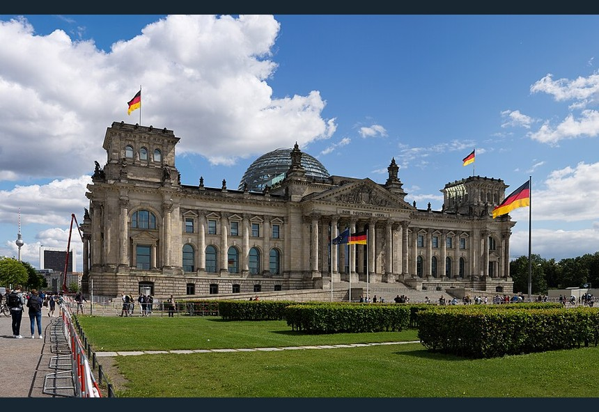
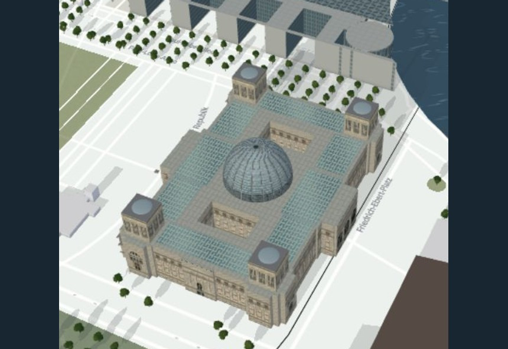
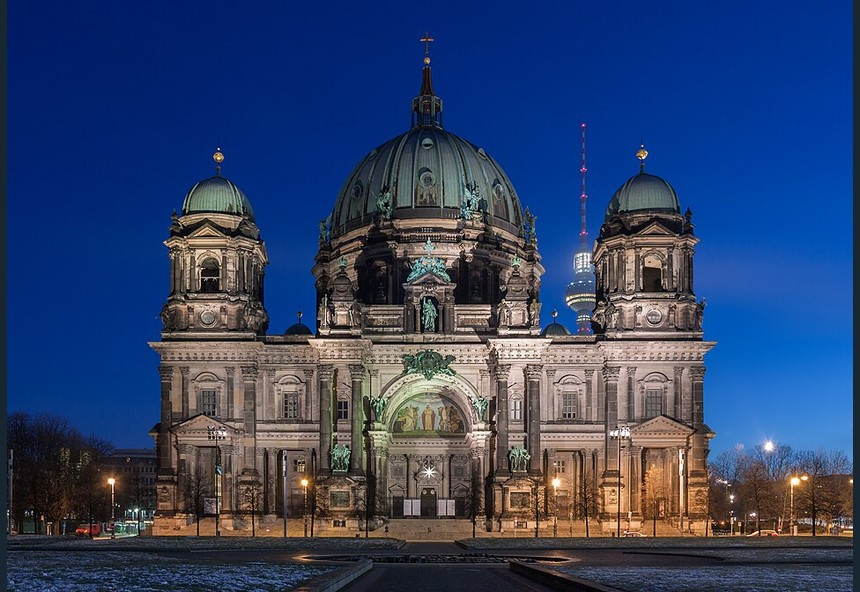
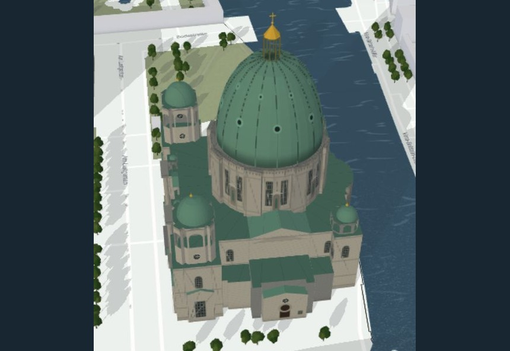
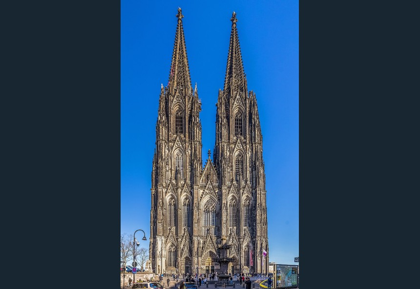
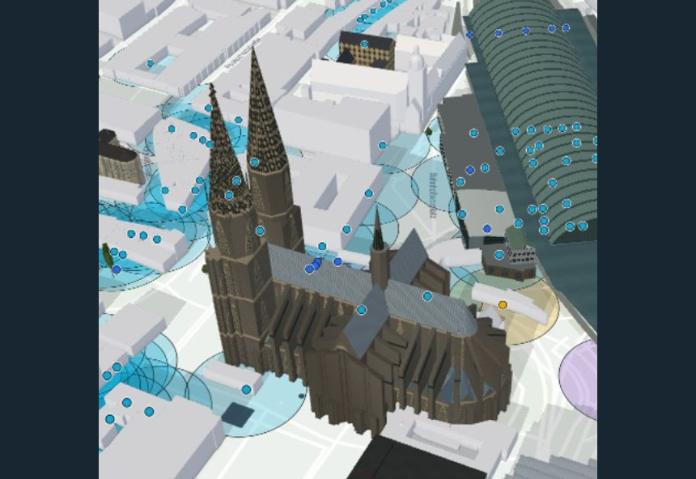

# 建筑立面是怎样画出来的

在 CrimeMaps 里，国会大厦的穹顶从街区的轮廓中升起。拉近后，墙上的窗洞、石材分缝和玻璃框架也逐渐清晰。远处能看出是哪栋楼，近处能读懂每一面墙，这两种效果分别依靠建筑几何和表面绘制。

## 三座地标，六个视角

左栏是实景照片，右栏是项目三维地图截图。点击图片可以放大。照片和地图取景角度不同，适合比较建筑特征。

| 实景照片 | CrimeMaps 三维地图 |
| :--- | :--- |
|  |  |
| **德国国会大厦 · 柏林** · [Jörg Braukmann](https://commons.wikimedia.org/wiki/File:Reichstagsgeb%C3%A4ude_(Westfassade).jpg) · [CC BY-SA 4.0](https://creativecommons.org/licenses/by-sa/4.0) | 石砌立面与中央玻璃穹顶 |
|  |  |
| **柏林大教堂 · 柏林** · [Ansgar Koreng](https://commons.wikimedia.org/wiki/File:141227_Berliner_Dom.jpg) · [CC BY 3.0 de](https://creativecommons.org/licenses/by/3.0/de/deed.en) | 主穹顶与围绕它的小塔 |
|  |  |
| **科隆大教堂 · 科隆** · [Raimond Spekking](https://commons.wikimedia.org/wiki/File:K%C3%B6lner_Dom_-_Westfassade_2022_ohne_Ger%C3%BCst-0968_b.jpg) · [CC BY-SA 4.0](https://creativecommons.org/licenses/by-sa/4.0) | 西侧双尖塔与中殿 |

**国会大厦**　先看中央玻璃穹顶和四角塔楼，再看石砌外墙。绕到另一面时，窗列仍应落在对应墙面上。国会大厦有单独的立面布局。[查看国会大厦的绘制规则](../web/src/painted/root500/safety/facade-reichstag-layouts.ts)

**柏林大教堂**　先看主穹顶与角塔的高低关系，再看鼓座上深色长窗的排列。穹顶的弧线在天空前形成轮廓，窗列则帮助读者辨认穹顶下方的墙面。

**科隆大教堂**　正面照片最容易辨认西侧双塔；从地图斜看，还能看见向后延伸的中殿和两侧的扶壁。比较时可以分别看塔尖、屋脊和墙上的竖向分格。

## 从参考画面到模型表面

1. **逐面读建筑。** 从实景图和建筑说明中记录临街面、侧面、院墙和屋顶的特征。玻璃出现在哪一段、窗户从多高开始、哪些区域是连续实墙，都与朝向有关。
2. **把说明绑定到模型。** 用城市、建筑对象和部件标识找到对应的模型表面。白模提供轮廓、折面及体量，经过核对的立面说明决定哪些面可以继续细画。[建筑说明与模型的绑定](../web/src/painted/root500/safety/facade-description-bindings.ts)
3. **用规则绘制材质。** 在 WebGL 着色器中，以墙面上的位置和高度计算底色、窗框间距、石材分缝或金属接缝。拱窗和窗框的基础画法可以复用，每栋建筑的分区、比例与排列单独设定。已有来源材质的表面也可以读取纹理图。[共享绘制规则](../web/src/painted/root500/safety/facade-layouts.ts) · [来源材质贴图](../web/src/safety/source-diffuse-texture.ts)
4. **在三维视角中核对。** 近看窗格有没有画到院墙或屋顶，斜看相邻两面的交界，拉远看主要轮廓是否仍然清楚。参考画面没有覆盖的面可以只保留基础材质。[按朝向区分绘制范围的实例](../web/src/painted/root500/safety/facade-elbphilharmonie-layouts.ts)

一个具体例子是埃森音乐厅。它的铜屋顶已有真实折面，程序沿折面画出铜板接缝；后翼临街面的高窗只在特定朝向、高度和墙段内出现。玻璃亭与院墙使用各自的规则。[埃森音乐厅的着色器](https://github.com/LN6666/crimemaps-Essen/blob/4ed694157d97c02d1d8de2148665b7063db614a1/web/src/painted/infill/safety/infill-philharmonie-reconstruction-features.ts)

## 图像来源

照片的作者、原图和许可列在各图下方。照片为网页排版缩放并加衬边，沿用对应许可。右栏取自 CrimeMaps 的柏林和科隆三维地图，底图数据 © [OpenStreetMap contributors](https://www.openstreetmap.org/copyright)。

[打开柏林地图](https://ln6666.github.io/crimemaps-Berlin/map/) · [打开科隆地图](https://ln6666.github.io/crimemaps-Cologne/map/) · [返回首页](../README.md)
